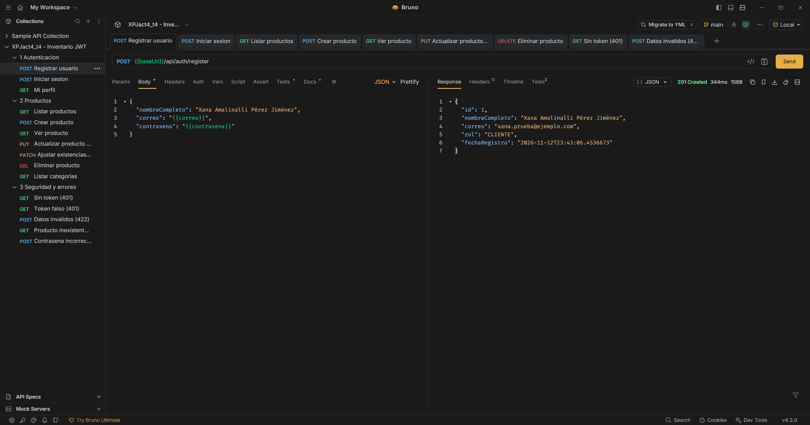
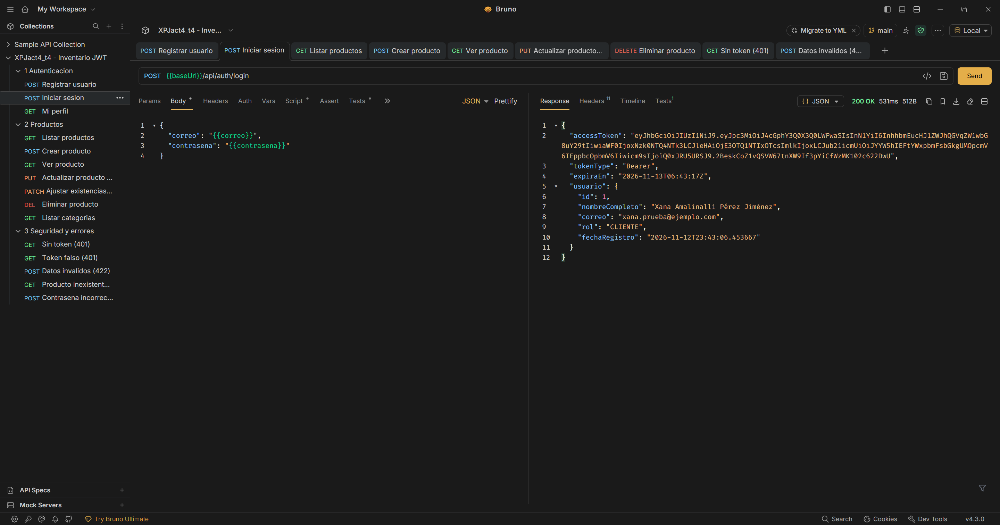
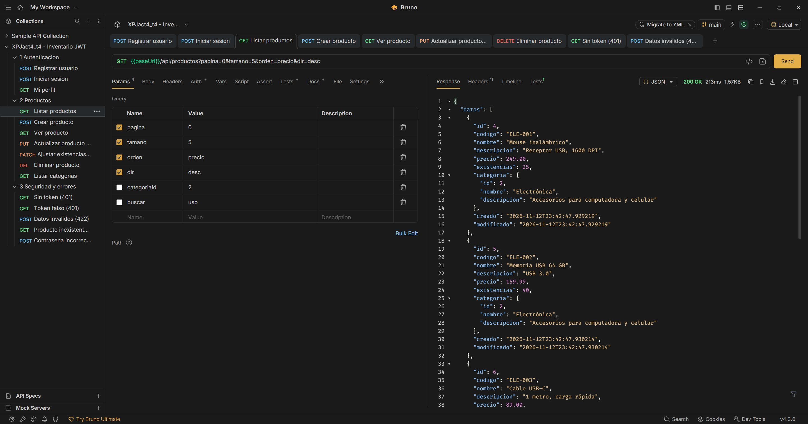
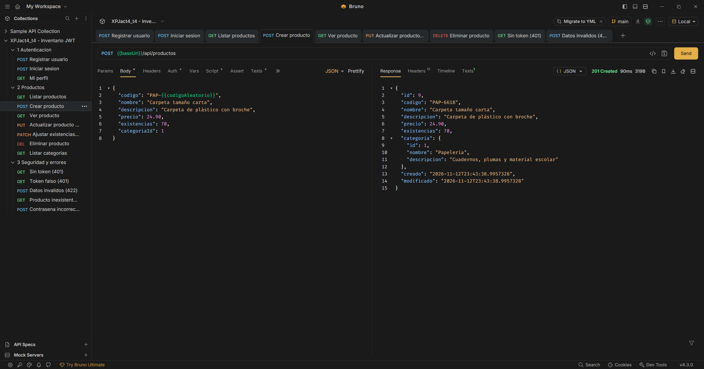
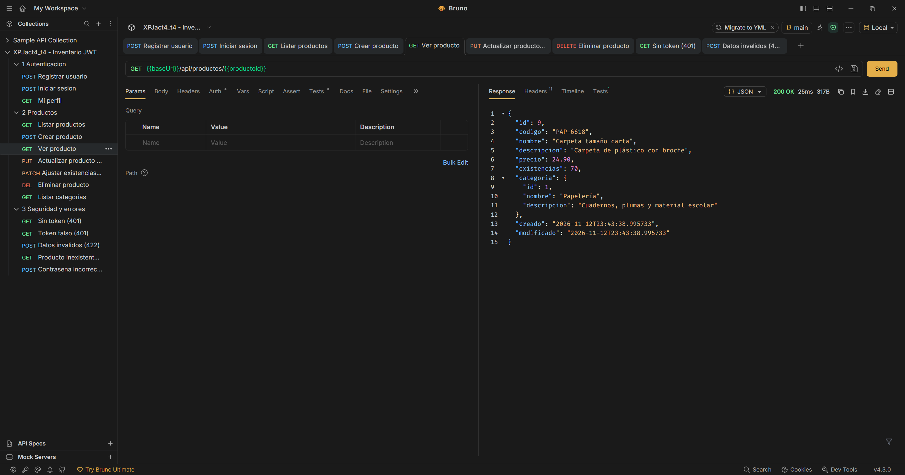
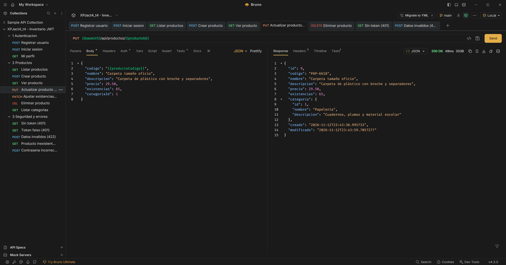
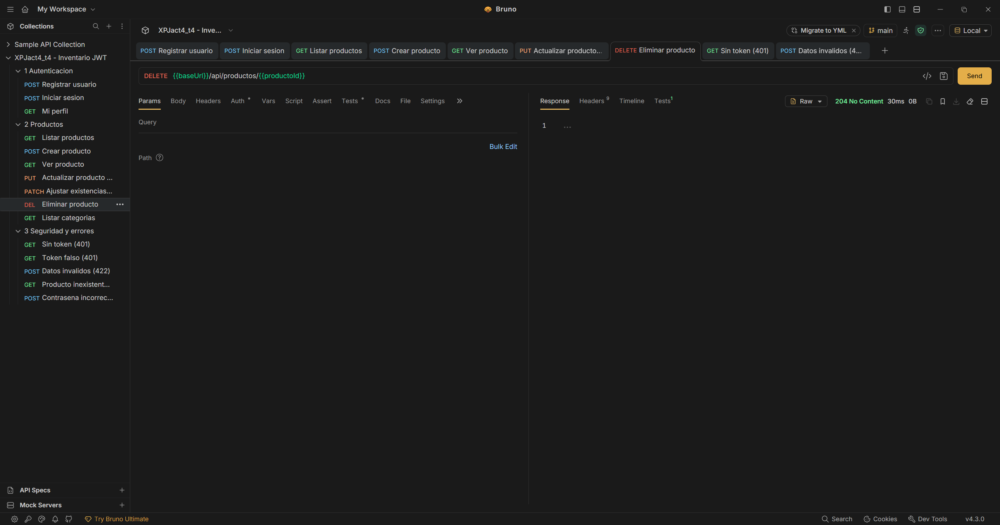
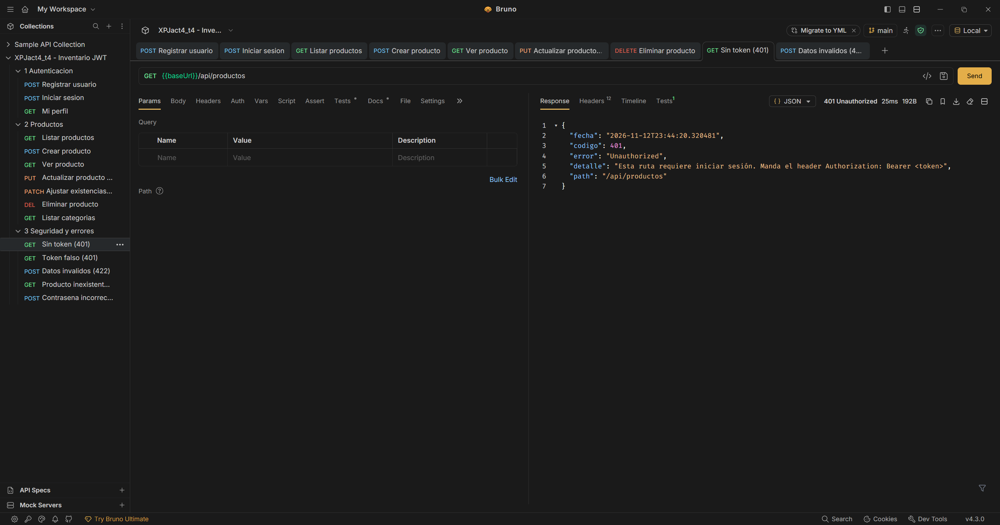
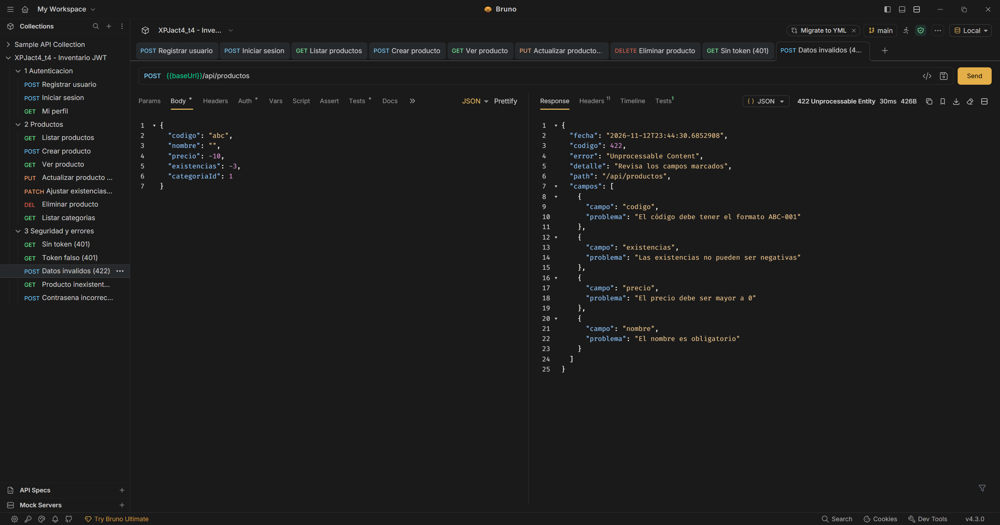

# XPJact4_t4 · API de Inventario con Spring Security y JWT

**Alumna:** Xana Amalinalli Pérez Jiménez · Matrícula 23161091
**Actividad 4, Tema 4:** API REST pura (sin vistas) con autenticación real por JWT, CRUD protegido, DTOs, validación y colección de Bruno.

La API administra el inventario de una tienda: **productos** que pertenecen a una **categoría** (relación `@ManyToOne` / `@OneToMany`).

## Tecnologías
| | |
|---|---|
| Lenguaje / framework | Java 21 · Spring Boot 4.1 |
| Seguridad | Spring Security · JWT con la librería **JJWT 0.12** (HS256) · BCrypt |
| Datos | Spring Data JPA · MySQL |
| Validación | Jakarta Bean Validation (`@Valid`, `@NotBlank`, `@Email`, `@Pattern`, `@DecimalMin`, `@PositiveOrZero`…) |
| Pruebas | Bruno (colección en [`/bruno`](bruno)) · prueba automática con JUnit + MockMvc |

## ¿Cómo funciona la seguridad?

```
Cliente                                  API
  │ POST /api/auth/register  ─────────▶  guarda el usuario con la contraseña cifrada (BCrypt)  → 201
  │ POST /api/auth/login     ─────────▶  AuthenticationManager compara correo + contraseña
  │ ◀────────────── { accessToken }      JwtUtil firma un JWT (HS256, dura 60 min)            → 200
  │
  │ GET /api/productos
  │ Authorization: Bearer <token> ────▶  JwtAuthFilter (OncePerRequestFilter)
  │                                       ├─ firma, emisor y expiración válidos → usuario autenticado → 200
  │                                       └─ sin token / token falso / vencido  → 401 en JSON
```

- `SecurityConfig`: API **stateless** (sin sesión ni cookies, CSRF desactivado). Solo `register`, `login` y `GET /api` son públicos; `anyRequest().authenticated()` protege todo lo demás.
- `JwtAuthFilter`: filtro propio que corre antes de `UsernamePasswordAuthenticationFilter`, lee el header `Authorization`, valida el token y llena el `SecurityContext`.
- `ManejadorNoAutenticado`: `AuthenticationEntryPoint` que manda el 401 al `@RestControllerAdvice` para que tenga el mismo formato JSON que los demás errores.

Contenido del token (payload):
```json
{
  "iss": "xpjact4_t4-api",
  "sub": "xana.prueba@ejemplo.com",
  "iat": 1794546000,
  "exp": 1794549600,
  "id": 1,
  "nombre": "Xana Amalinalli Pérez Jiménez",
  "rol": "CLIENTE"
}
```

## Endpoints

| Método | Ruta | Acceso | Respuestas |
|---|---|---|---|
| GET | `/api` | Público | 200 |
| POST | `/api/auth/register` | Público | **201**, 409 correo repetido, 422 |
| POST | `/api/auth/login` | Público | **200** + token, 401 credenciales incorrectas, 422 |
| GET | `/api/auth/perfil` | Token | 200, 401 |
| GET | `/api/productos?pagina=0&tamano=10&orden=precio&dir=desc&categoriaId=1&buscar=usb` | Token | **200** paginado, 401 |
| GET | `/api/productos/{id}` | Token | **200**, 404, 401 |
| POST | `/api/productos` | Token | **201** + `Location`, 404 categoría, 409 código repetido, 422, 401 |
| PUT | `/api/productos/{id}` | Token | **200** (reemplaza todo), 404, 409, 422, 401 |
| PATCH | `/api/productos/{id}` | Token | **200** (solo precio y/o existencias), 404, 422, 401 |
| DELETE | `/api/productos/{id}` | Token | **204**, 404, 401 |
| GET | `/api/categorias` | Token | 200, 401 |

Ejemplo de error de validación (**422 Unprocessable Content**):
```json
{
  "fecha": "2026-11-12T23:09:55.3002227",
  "codigo": 422,
  "error": "Unprocessable Content",
  "detalle": "Revisa los campos marcados",
  "path": "/api/productos",
  "campos": [
    { "campo": "codigo", "problema": "El código debe tener el formato ABC-001" },
    { "campo": "precio", "problema": "El precio es obligatorio" }
  ]
}
```

## DTOs
Las entidades `Usuario`, `Producto` y `Categoria` nunca se regresan directamente.

| DTO | Para qué |
|---|---|
| `RegistroRequest`, `LoginRequest` | Entrada de autenticación, con validaciones |
| `UsuarioDTO` | Datos públicos del usuario, **sin contraseña** |
| `TokenResponse` | `accessToken`, `tokenType`, `expiraEn` y el usuario |
| `ProductoRequest` | Entrada de POST y PUT |
| `ProductoPatchRequest` | Entrada de PATCH (campos opcionales) |
| `ProductoDTO`, `CategoriaDTO` | Salida del producto con su categoría |
| `PaginaDTO<T>` | Página de resultados: `datos`, `paginaActual`, `totalElementos`, `totalPaginas`, `hayMas` |
| `ApiError` | Formato único de todos los errores |

## Estructura
```
src/main/java/com/example/xpjact4_t4/
├── config/       CargaInicial (categorías y productos de ejemplo)
├── controller/   AuthController, ProductoController, CategoriaController, InfoController
├── dto/          records de entrada y salida
├── entity/       Usuario (implementa UserDetails), Producto, Categoria
├── exception/    ManejadorGlobalErrores (@RestControllerAdvice) y excepciones 401/404/409
├── repository/   UsuarioRepository, ProductoRepository (consulta con filtros + paginación), CategoriaRepository
├── security/     SecurityConfig, JwtUtil, JwtAuthFilter, ManejadorNoAutenticado
└── service/      AuthService, ProductoService, Convertidor (entidad → DTO)
bruno/            colección de Bruno (15 peticiones, ambientes Local y VPS)
db/crear_bd.sql   base de datos y usuario de MySQL
```

## Colección de Bruno
En Bruno: **Open Collection** → carpeta `bruno` → elegir ambiente **Local** o **VPS**.

| Carpeta | Petición | Esperado |
|---|---|---|
| 1 Autenticacion | Registrar usuario | 201 (409 si ya existe) |
| | Iniciar sesion | 200, guarda `accessToken` |
| | Mi perfil | 200 |
| 2 Productos | Listar productos | 200 paginado |
| | Crear producto | 201, guarda `productoId` |
| | Ver producto | 200 |
| | Actualizar producto (PUT) | 200 |
| | Ajustar existencias (PATCH) | 200 |
| | Eliminar producto | 204 |
| | Listar categorias | 200 |
| 3 Seguridad y errores | **Sin token** | **401** |
| | Token falso | 401 |
| | Datos invalidos | 422 |
| | Producto inexistente | 404 |
| | Contrasena incorrecta | 401 |

La colección hereda el token desde `collection.bru` (`auth: bearer` con `{{accessToken}}`), así que basta con hacer login una vez. Todas las peticiones tienen pruebas automáticas; con **Run Collection** se ejecutan todas.

## Capturas de pantalla

### Registro → 201


### Login → 200 con el JWT


### Listar productos (paginado, con token) → 200


### Crear producto → 201


### Ver producto → 200


### Actualizar producto (PUT) → 200


### Eliminar producto → 204


### Ruta protegida sin token → 401


### Validación fallida → 422


## Ejecutar en local
1. Tener MySQL encendido. La base `xpjact4_t4` se crea sola (`createDatabaseIfNotExist=true`) con el usuario `root`; si usas otro usuario, ejecuta antes `db/crear_bd.sql`.
2. Si tu MySQL local tiene contraseña de root, defínela antes:
   ```powershell
   $env:DB_PASSWORD="tu_contraseña"
   ```
3. Arrancar:
   ```powershell
   .\mvnw spring-boot:run
   ```
4. Abrir http://localhost:8084/api
5. Prueba automática (no necesita MySQL, usa H2 en memoria): `.\mvnw test`

## Variables de entorno
| Variable | Uso | Valor por defecto (solo local) |
|---|---|---|
| `DB_URL` | URL JDBC de MySQL | `jdbc:mysql://localhost:3306/xpjact4_t4…` |
| `DB_USER` / `DB_PASSWORD` | Credenciales de MySQL | `root` / vacío |
| `JWT_SECRET` | Clave para firmar los tokens (mín. 32 caracteres) | clave de desarrollo |
| `JWT_MINUTOS` | Duración del token | 60 |
| `PORT` | Puerto del servidor | 8084 |

En el VPS las credenciales están en un archivo `.env` que solo existe en el servidor (los `*.env` están en `.gitignore`).

## API en el VPS
URL base: **http://IP_DEL_VPS:8084/api**
